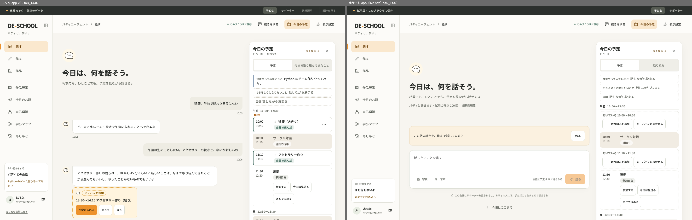
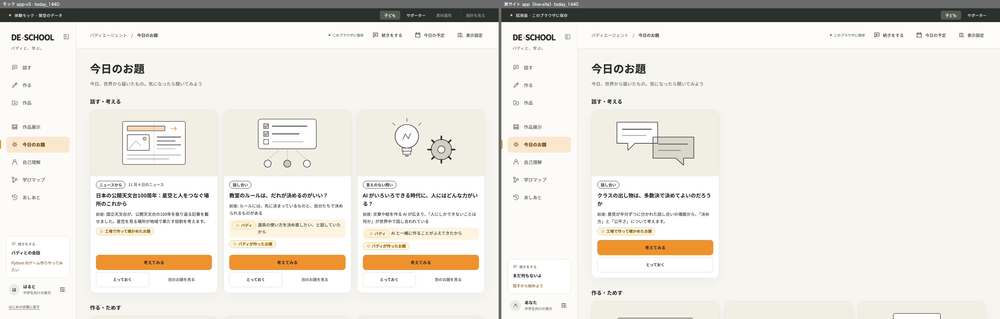
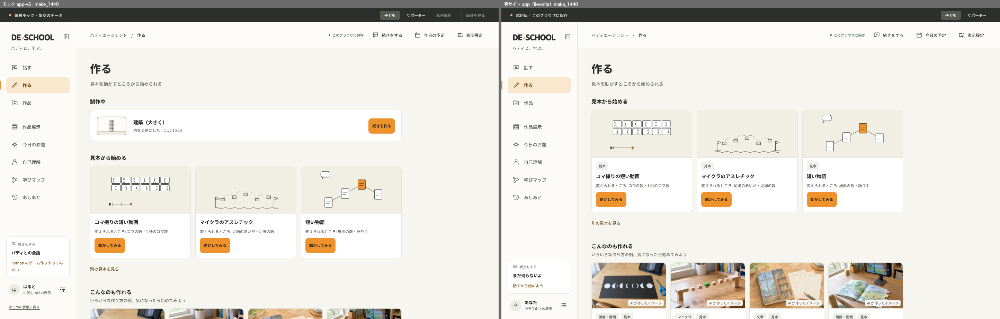
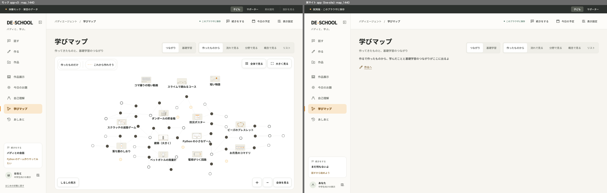
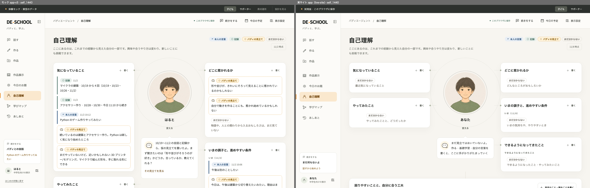
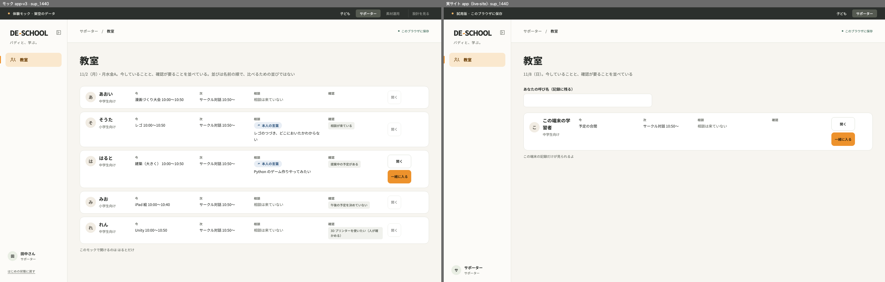

# DE-SCHOOL 学びのAIエージェント構想（Learning Buddy OS） — 遊ぶように、学ぶ

## プロジェクト概要：解決する課題と、誰のためのものか

このプロジェクトは、**伝統的な教育が合わない子どもたち（不登校を含む）**が、学習の意味を見出せず、学習に取り組むことが難しくなっている状況を、**AI バディエージェントとの協働を前提とした新しい学習体験**によって変える教育プロジェクトです。子どもたちが意欲的に学び、世界の面白さを発見し、自分の可能性を広げていけるようにします。

学習の設計を、実存的な教育（**作る・出会う**）へと再設計します。そして、**プロジェクトと基礎学習の往還**によって、学ぶことの意味づけを体感できるコンテンツを提供します。

- **誰のためのものか**: まずは弊校の教室 DE-SCHOOL の子どもたち。その後、他のフリースクールとホームラーナー（自宅学習者）へ
- **その先**: さまざまな教育環境、特に学校の探究学習の時間などで、新しい学びのツールとして展開できると考えています

仕組みとしては、子ども一人ひとりに専属の「バディエージェント」を付け、その背後で Claude のエージェント群が検証済みの教材を作り続けます（コンテンツファクトリー）。

---

## 遊ぶように、学ぶ

子どもが一番深く学ぶのは、本人にとって本物の目的があるときです。友達に遊んでもらう九九のクイズを作る。音に反応して光る LED の木を作る。マインクラフトでパリの街を再現する。**自分が作りたいと思ったものを、実際に動かし、誰かに届ける。** その中では、知識は「覚えさせられるもの」ではなく、「必要になって使うもの」になります。

このプロジェクトは、学びを**プロジェクトから始め、そこで出会った概念を、その子にとって意味を持つ学びとして紡いでいきます**。**プロジェクトが学びを呼び、学びが次のプロジェクトを良くする。** この行き来を、バディエージェントが支えます。

## なぜ必要か

DE-SCHOOL は、テクノロジーを使った「創ること」を中心に置く探究型のフリースクールです（[参考: DE-SCHOOLとは？](https://note.com/deschool/n/n2a6d16f78b2a)）。熟練のサポーターは、子ども一人ひとりの関心や状態を見て関わり方を変えています。ただ、この関わりを子ども全員に毎日届けるには、人の手だけでは次のものが足りませんでした。

1. その子の関心と学びをつなぐ素材を、根拠を確かめて毎日用意すること
2. まだ言葉になっていない関心への入口
3. 一日を一緒に組む相棒
4. 観察と知恵を次の支援へつなぐ仕組み

AI エージェントによって、子ども全員に専属のバディを付け、裏側では教材を作り続けることが初めて現実的になりました。人は、子どもとの関わりと「この教材を出してよいか」の判断に集中します。

## 子どもが使う画面

| 入口 | 子どもがすること |
|---|---|
| 話す / 今日の予定 | バディエージェントと話しながら一日を組む |
| 作る | アイデアを練って試し、仕上げる |
| 作品 / 作品展示 | 作ってきたものを眺める・見せる |
| 今日のお題 | 世界から届いた発見に乗る |
| 自己理解 | 自分の好きなことや合う取り組み方を知る（本人が書き換えられる） |
| 学びマップ | 作ったものと、つながる単元・基礎学習を眺める |
| あしあと | 前回の続きから再開する |
| サポーター画面 | 教室の様子を見る・子どもの画面に「一緒に入る」 |

| 話す | 今日のお題 |
|---|---|
|  |  |
| **作る** | **学びマップ** |
|  |  |
| **自己理解** | **サポーター画面** |
|  |  |

各画像は、左がモック（`app-v3/`）、右が実際の学習サイトです。ほかの画面写真は [`screens/`](screens/) にあります。

## 安心して使えるための約束

- 確かめていない教材は、子どもに出ない
- 子どもの会話や記録は、教材を作る側に渡さない
- AI の見立てと本人の言葉を分けて表示し、本人が書き換えられる
- 点数・ランキング・順位を子どもの画面で使わない
- 費用には上限があり、上限を増やせるのは人だけ

## モックを動かす

ビルドは要りません。ブラウザで開くだけで動きます。データはすべて架空です。

```sh
open app-v3/index.html
```

## このリポジトリについて

ハッカソン提出用の公開リポジトリです。子ども向け画面のモック（`app-v3/`）と画面写真（`screens/`）だけを置いています。学習サイト本体、コンテンツファクトリー、設計書、教材は非公開で開発しています。

人物名・予定・会話・作品など、モックと画面写真に出てくる情報はすべて架空です。

## ライセンス

未設定（All rights reserved）。再配布・商用利用はできません。ご相談は作者まで。
